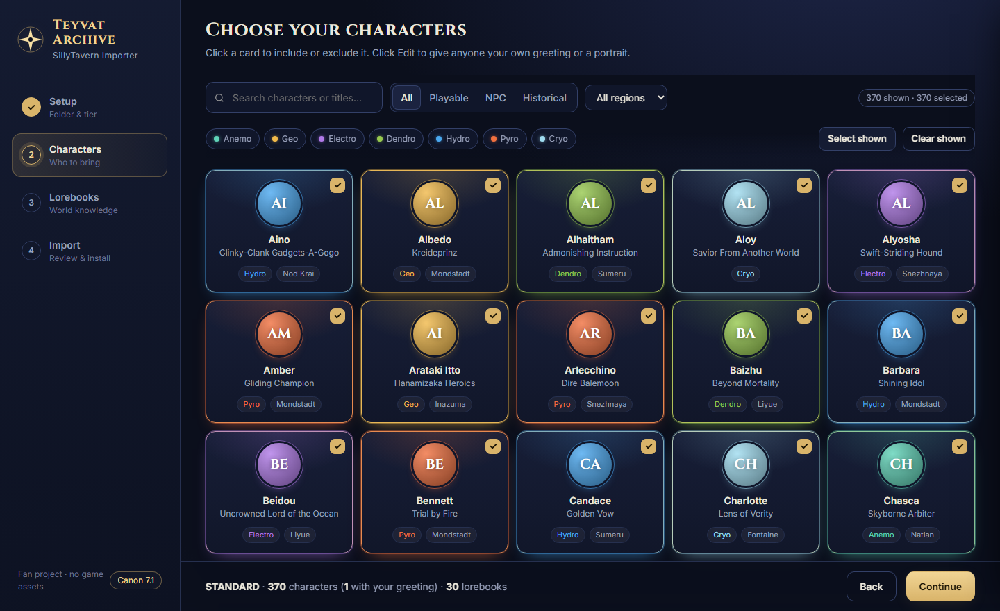
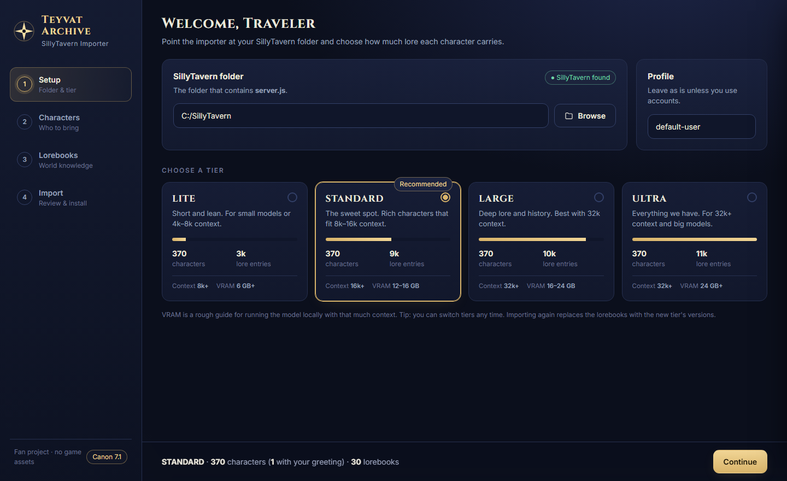
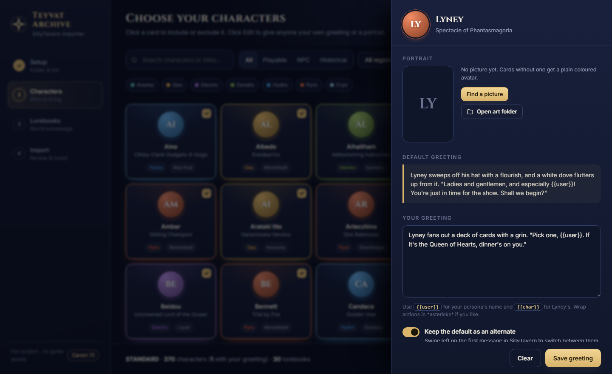

Roleplay with **every Genshin Impact character** in [SillyTavern](https://github.com/SillyTavern/SillyTavern).
370 characters and thousands of lore entries, up to Version 7.1, ready to import in a few clicks.

## What you get

- All 122 playable characters, plus NPCs and figures from history
- Lorebooks for places, factions, history and more, so characters know their world
- Characters only know what they should know, so no accidental spoilers
- An easy app to install it all, with your own greetings and pictures

## Install

1. Download the latest zip from [Releases](https://github.com/JohnVegetables/tevyat-archive/releases/latest).
2. Unzip it.
3. Open **Teyvat Importer.exe**.

The app tells you when a new version is out.

## How to use it

1. **Setup:** pick your SillyTavern folder and a tier. Not sure? Use **STANDARD**.
2. **Characters:** pick who you want. Click **Edit** to add your own greeting or a picture.
3. **Lorebooks:** leave the recommended ones on.
4. **Import:** close SillyTavern, click **Import**, then start SillyTavern again.

  
  

That's it. Pick a character in SillyTavern and start chatting.

## Need help?

See the [wiki](https://github.com/JohnVegetables/tevyat-archive/wiki).

## License

[Apache 2.0](LICENSE). You can change and share it, but keep the credit (see [NOTICE](NOTICE)).

Unofficial fan project. Genshin Impact belongs to HoYoverse. No game art is included.
